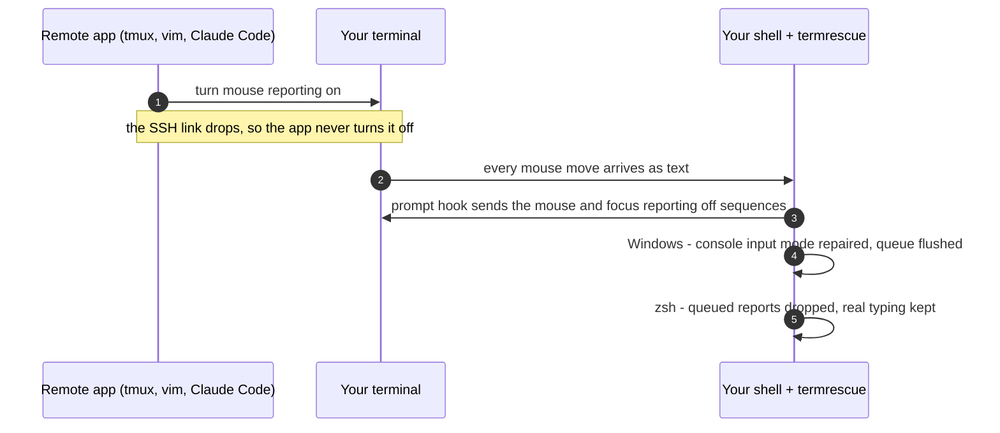

<div align="center">

# termrescue

**Your SSH session dropped. Now every mouse move types `[<35;45;23M` into your shell.**<br>
termrescue fixes that automatically, at every prompt.

[](https://github.com/Guinerve/termrescue/actions/workflows/ci.yml)


</div>

## Why this happens

Programs that run over SSH (tmux, vim, htop, Claude Code and so on) switch your **local** terminal into *mouse-reporting mode*. When the connection drops, they never get the chance to switch it back. Your terminal keeps sending every mouse move and click as text, and your shell types it out.

On **Windows** a second thing gets stuck. `ssh.exe` switches the console into *virtual-terminal input* mode, and if it dies without switching back, PowerShell reads raw escape codes as if you typed them, and PowerShell has no `reset` command to fall back on. termrescue repairs both.

## Quick start

<table>
<tr><th>Windows (PowerShell 5.1 or 7)</th><th>macOS / Linux (zsh or bash)</th></tr>
<tr><td>

```powershell
uv tool install git+https://github.com/Guinerve/termrescue
termrescue install
```

</td><td>

```sh
uv tool install git+https://github.com/Guinerve/termrescue
termrescue install
```

</td></tr>
</table>

Open a new terminal and you're done. termrescue needs [uv](https://docs.astral.sh/uv/getting-started/installation/) (or use `pipx install git+…`).

<details>
<summary><b>Windows notes</b></summary>

- `termrescue install` adds one line to `$PROFILE` for every PowerShell edition it finds, including Windows PowerShell when it isn't on `PATH`.
- If Windows PowerShell's execution policy would block your profile, `install` prints the fix: `Set-ExecutionPolicy RemoteSigned -Scope CurrentUser`.
- Using oh-my-posh or starship? Keep the termrescue line **after** theirs. termrescue wraps whatever prompt exists when it loads, and keeps `$LASTEXITCODE` intact.

</details>

<details>
<summary><b>Recommended SSH settings</b></summary>

Add to `~/.ssh/config` (Windows: `C:\Users\<you>\.ssh\config`) so a dead link exits after about 45 seconds instead of hanging:

```
Host *
  ServerAliveInterval 15
  ServerAliveCountMax 3
```

A hung session can also be killed at once: press Enter, then type `~.`

</details>

## What you get

| | |
|---|---|
| **Prompt hook** for PowerShell, zsh and bash | Switches mouse and focus reporting off before every prompt. Plain shell or PowerShell, so no Python runs at each prompt. |
| **Windows console repair** | Turns virtual-terminal input back off when a dead program left it on, and flushes the queued garbage. |
| **Queue cleanup** (zsh) | Drops mouse reports already waiting in the input queue and **keeps what you actually typed**, arrow keys included. |
| `termrescue doctor` | Shows what's stuck right now. Exits 1 if anything is. |
| `termrescue capture` | Records exactly what your terminal sends and decodes it. |
| `termrescue fix` | Full manual reset: alternate screen, bracketed paste, cursor keys, kitty keyboard protocol. |
| `termrescue run -- ssh host` | Runs a command, then resets the terminal however it exits. |
| `termrescue uninstall` | Removes the hook and its profile line. |

## Diagnose

`capture` turns the garbage into something readable:

```console
$ termrescue capture
Press q (or wait 10s) to stop. Move the mouse, click, switch windows: everything the terminal sends is recorded.
Raw: ^[[<35;45;23M^[[<35;46;23M^[[<0;46;23M^[[<0;46;23m^[[O
^[[<35;45;23M           mouse  sgr  button 35  column 45  row 23  (motion)
^[[<35;46;23M           mouse  sgr  button 35  column 46  row 23  (motion)
^[[<0;46;23M            mouse  sgr  button 0  column 46  row 23  (press)
^[[<0;46;23m            mouse  sgr  button 0  column 46  row 23  (release)
^[[O                    focus  out
```

On Windows, `doctor` and `capture` also check the console input mode:

```console
Console input mode 0x03F7: virtual-terminal input is ON. PowerShell and cmd will read the terminal's escape codes (mouse reports, arrow keys) as typed text. `termrescue fix` turns it off.
```

## How it works



Terminal modes are switched on with `ESC [ ? n h` and off with `ESC [ ? n l`. Mouse reporting uses modes 9, 1000–1003 and 1005/1006/1015/1016, and focus reporting uses 1004. Sending "off" for all of them at a prompt is always safe, because nothing should be reporting when no program is running.

- **Windows:** the PowerShell hook reads the console mode with `GetConsoleMode`, clears `ENABLE_VIRTUAL_TERMINAL_INPUT` if it's set, and flushes the input queue. Its small native helper is compiled after your first command, so opening a terminal stays fast.
- **zsh:** a `line-init` widget reads whatever input is pending, strips the mouse and focus reports, and pushes the rest back with `zle -U`. It chains with `add-zle-hook-widget`, so other plugins keep working.

## Tested on real shells and consoles

CI runs on Windows, macOS and Linux. The integration tests drive real shells and real consoles, not mocks:

| Platform | What the tests do |
|---|---|
| **Windows** | Open a brand-new console, break it the way a dying `ssh.exe` does, then check that `termrescue fix` and the PowerShell hook repair it. The hook is tested in both **Windows PowerShell 5.1 and PowerShell 7**, including that your own prompt, `$LASTEXITCODE` and `$?` survive, so prompt themes such as starship still show failures. |
| **zsh** | Run an interactive zsh in a pseudo-terminal. A program enables mouse reporting and is killed with `kill -9`, and the next prompt must reset it. Queued mouse reports followed by `echo kept` must run exactly `echo kept` (without termrescue, zsh would run fragments like `35` and `23Mecho` as commands). |
| **bash** | Same reset check, and an existing `PROMPT_COMMAND` must keep working and still see the last command's exit status. |
| **Everywhere** | `doctor`'s side of the terminal conversation, install idempotence (including UTF-16 profiles, and Windows line endings on Windows), and a check that every hook sends exactly the same reset sequence. |

```sh
uv run pytest -v -rs
```

## Limits

- cmd.exe has no prompt hook. Use PowerShell, or run `termrescue fix`.
- bash can't drop reports that were already queued, because it has no line-init hook.
- `doctor`'s mode table depends on the terminal answering DECRQM queries. If it doesn't, the result shows "unknown" rather than a guess.
- Terminal support hasn't been verified by hand yet.

## Roadmap

- [ ] fish hook
- [ ] winget / Scoop / Homebrew packages
- [ ] Hand-verified support table: Windows Terminal, iTerm2, Ghostty, Terminal.app, kitty, WezTerm
- [ ] Recorded demo GIF
