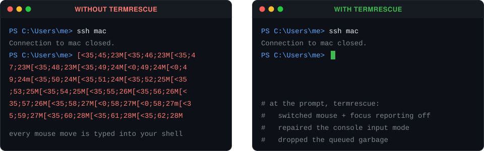
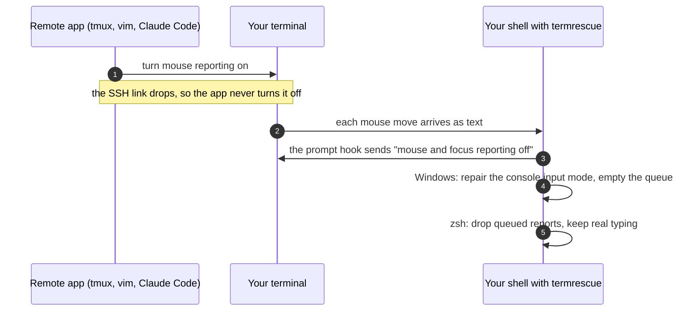

<div align="center">

# termrescue

**Your SSH session dropped. Now every mouse move types `[<35;45;23M` into your shell.**<br>
termrescue switches the stuck modes off at every prompt.

[](https://github.com/Guinerve/termrescue/actions/workflows/ci.yml)




<sub>Two real zsh sessions in a pseudo terminal. A script plays the terminal and sends mouse reports only while mouse mode is on. <a href="assets/record_hero.py">assets/record_hero.py</a> makes this image.</sub>

</div>

## Why I made this

Programs that run over SSH, such as tmux, vim and Claude Code, switch your **local** terminal into mouse reporting mode. When the link drops, they never switch it back. The terminal then sends each mouse move as text, and the shell types it out.

On Windows a second thing gets stuck. `ssh.exe` turns on the console's *virtual terminal input* mode. If ssh dies, the mode stays on and PowerShell reads raw escape codes as typing. PowerShell has no `reset` command, so the usual fix is to close the tab. I built termrescue to repair both at every prompt, with no Python in the prompt path.

## Quick start

<table>
<tr><th>Windows (PowerShell 5.1 or 7)</th><th>macOS and Linux (zsh or bash)</th></tr>
<tr><td>

```powershell
uv tool install git+https://github.com/Guinerve/termrescue
termrescue install
```

</td><td>

```sh
uv tool install git+https://github.com/Guinerve/termrescue
termrescue install
```

</td></tr>
</table>

Then open a new terminal window. You need [uv](https://docs.astral.sh/uv/getting-started/installation/). `pipx install git+https://github.com/Guinerve/termrescue` also works.

`termrescue install` writes a hook file to your home directory and adds one line to your shell's startup file:

| Shell | Startup file |
|---|---|
| zsh | `~/.zshrc`, or `$ZDOTDIR/.zshrc` if you set `ZDOTDIR` |
| bash | `~/.bashrc`. On macOS also the first of `~/.bash_profile`, `~/.bash_login` and `~/.profile` that exists, because Terminal.app starts login shells. If none exists, it creates `~/.profile` |
| PowerShell | `$PROFILE` of each edition it finds, also Windows PowerShell when it is not on `PATH` |

`termrescue uninstall` removes that line and the hook file. It removes only the exact line that `install` added.

<details>
<summary><b>Windows notes</b></summary>

- If the execution policy blocks your profile, `install` tells you. The fix is `Set-ExecutionPolicy RemoteSigned -Scope CurrentUser`.
- If you use oh-my-posh or starship, keep the termrescue line **after** their line. termrescue wraps the prompt that exists when it loads.
- The hook keeps `$LASTEXITCODE` and `$?`, so your prompt theme still shows failed commands.

</details>

<details>
<summary><b>SSH settings that help</b></summary>

Add this to `~/.ssh/config` (on Windows: `C:\Users\<you>\.ssh\config`). A dead link then closes after about 45 seconds instead of hanging:

```
Host *
  ServerAliveInterval 15
  ServerAliveCountMax 3
```

To close a hung session at once, press Enter, then type `~.`

</details>

## Commands

| Command | What it does |
|---|---|
| `termrescue install` | Adds the prompt hook for PowerShell, zsh or bash. The hook is plain shell code. |
| `termrescue doctor` | Shows which modes are on now. Exits 1 if a mode is stuck. |
| `termrescue capture` | Records what your terminal sends and decodes it. |
| `termrescue fix` | Full reset: also alternate screen, bracketed paste, cursor keys and the kitty keyboard protocol. |
| `termrescue run -- ssh host` | Runs a command, then resets the terminal when the command stops. |
| `termrescue uninstall` | Removes the hook. |

At each prompt, the hook does this:

- It switches mouse reporting and focus reporting off.
- On Windows, it turns virtual terminal input off if a dead program left it on. Then it empties the input queue.
- In zsh, it removes mouse reports that are already in the input queue. It keeps what you typed, arrow keys too.

## Find out what is stuck

`capture` decodes the garbage:

```console
$ termrescue capture
Press q to stop, or wait 10 s. Move the mouse, click or switch windows. termrescue records all that the terminal sends.
Raw: ^[[<35;45;23M^[[<35;46;23M^[[<0;46;23M^[[<0;46;23m^[[O
^[[<35;45;23M           mouse  sgr  button 35  column 45  row 23  (motion)
^[[<35;46;23M           mouse  sgr  button 35  column 46  row 23  (motion)
^[[<0;46;23M            mouse  sgr  button 0  column 46  row 23  (press)
^[[<0;46;23m            mouse  sgr  button 0  column 46  row 23  (release)
^[[O                    focus  out
```

On Windows, `doctor` and `capture` also show the console input mode:

```console
Console input mode 0x03F7: virtual terminal input is ON. PowerShell and cmd read the terminal's escape codes (mouse reports, arrow keys) as typed text. `termrescue fix` turns it off.
```

## How it works



A terminal mode goes on with `ESC [ ? n h` and off with `ESC [ ? n l`. Mouse reporting uses modes 9, 1000 to 1003, 1005, 1006, 1015 and 1016. Focus reporting uses mode 1004. At a prompt, no program should report mouse or focus events. So it is safe to send "off" for all of these modes each time.

- **PowerShell:** the hook reads the console mode with `GetConsoleMode`. If `ENABLE_VIRTUAL_TERMINAL_INPUT` is set, it clears it and empties the input queue. The small native helper compiles after your first command, so a new terminal still opens fast.
- **zsh:** a `line-init` widget reads the input that is waiting. It removes the mouse and focus reports and gives the rest back with `zle -U`. It uses `add-zle-hook-widget`, so other plugins still work.
- **bash:** the hook goes first in `PROMPT_COMMAND` and passes on the last exit status unchanged.

## Other ways to fix this

termrescue is not the only fix. You can choose a smaller one:

- Run `reset` after each drop. It also clears the screen, and PowerShell does not have it.
- Add a `printf` of the "off" sequences to your own `PROMPT_COMMAND` or `precmd`. This is what the bash hook does.
- Use an SSH wrapper such as [zc](https://github.com/marcbowes/zc). It restores the terminal and reconnects after a drop.

termrescue adds the Windows console repair, the zsh queue cleanup and the `doctor` and `capture` tools.

## Tests

CI runs the tests on Windows, macOS and Linux. The integration tests drive real shells and real consoles:

| Platform | What the tests do |
|---|---|
| **Windows** | Open a new console and break it the way a dying `ssh.exe` does. Then check that `termrescue fix` and the PowerShell hook repair it. Both **Windows PowerShell 5.1 and PowerShell 7** run the hook. Your own prompt, `$LASTEXITCODE` and `$?` must survive. |
| **zsh** | Run zsh in a pseudo terminal. A program turns on mouse reporting and gets `kill -9`. The next prompt must reset it. Mouse reports queued before `echo kept` must leave exactly `echo kept`. Without termrescue, zsh runs fragments such as `35` and `23Mecho` as commands. |
| **bash** | The same reset check. Your own `PROMPT_COMMAND` must still run and see the last exit status. The hook must also load under `set -u`. |
| **All** | The `doctor` exchange with the terminal. Install and uninstall with UTF-16 profiles, bytes that are not UTF-8, Windows line endings, `ZDOTDIR` and macOS login files. A check that all three hooks send the same reset sequence. |

```sh
uv run pytest -v -rs
```

On macOS this gives 62 passed and 3 skipped. The 3 skipped tests need a Windows console.

## Limits

- cmd.exe has no prompt hook. Use PowerShell, or run `termrescue fix`.
- bash cannot drop reports that are already queued, because it has no hook when the line editor starts.
- `doctor` needs a terminal that answers DECRQM mode queries. If the terminal does not answer, `doctor` says the state is unknown.
- I checked it by hand on my own machine only. There, the prompt hook switched the stuck mouse reporting off, and mouse moves stopped typing escape codes. Other terminals are not checked by hand yet.

## Roadmap

- [ ] fish hook
- [ ] winget, Scoop and Homebrew packages
- [ ] A support table checked by hand: Windows Terminal, iTerm2, Ghostty, Terminal.app, kitty, WezTerm

## Licence

MIT. See [LICENSE](LICENSE).
